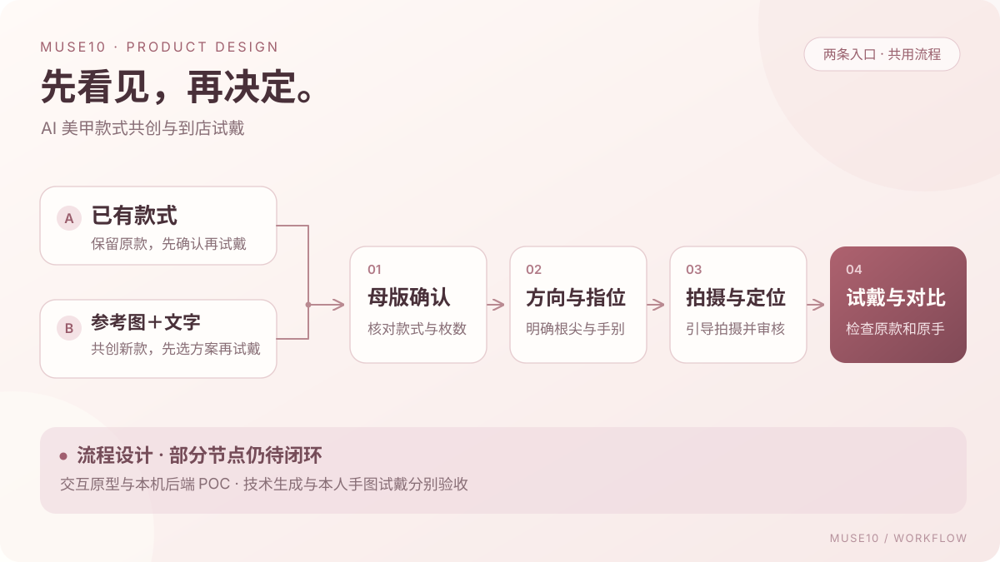
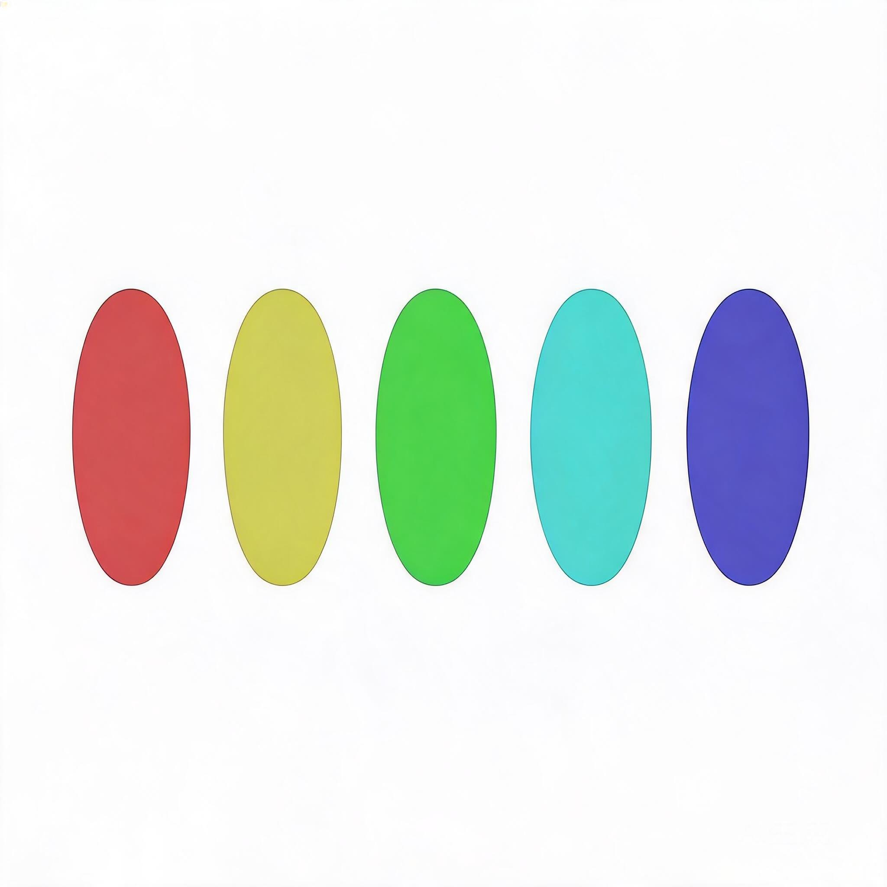

# Muse10｜AI 美甲款式共创与到店试戴

把参考款式、个人上手预览与局部修改需求串成一条可确认的产品流程，帮助消费者在制作前表达并判断自己想要的美甲效果。

[个人网站项目案例](https://wangyangjuan.surge.sh/projects/muse10-ai-nails.html)

## 项目概况

Muse10 是一个持续迭代的个人共建项目，开始于 2026 年 9 月。当前正在验证高端美甲门店的到店试戴方向：消费者使用，门店是拟付费方。现有交付包括需求与交互原型、商品视觉生成 Skill，以及本机后端 POC；门店价值、真实付费和稳定的本人手图试戴效果仍需验证。

我在两人共建中承担用户与竞品研究、产品范围和流程设计、交互原型、Prompt 迭代、Badcase 整理及验收标准设计，并借助 AI 编程工具推进原型和后端验证。商品视觉 Skill 由我与协作者共同封装。

## 从什么问题开始

参考图能够表达款式，却未必能回答“这套甲在我手上是什么效果”。消费者也希望只调整某一枚甲片，保留其余手指的设计，而整图重新生成容易改动颜色、饰件、长度或指位。

早期收集的 9 份消费者便利问卷中，8 人提到无法提前看到本人上手效果，7 人希望只改目标手指、其他手指保持不变，5 人希望先完成设计再决定穿戴甲或到店制作。这些结果用于识别方向，不代表门店采购需求或市场整体偏好。

## 两条产品路径

| 路径 | 使用场景 | 关键决策 |
| --- | --- | --- |
| 已有款式，确认后试戴 | 已经选定参考款式，想判断个人上手效果 | 把原款保留作为主要目标；已有合格母版可以复用 |
| 参考图与文字共创新款，再试戴 | 有灵感但还没有确定款式 | 明确想保留、去掉和新增的内容，先确认方案再进入试戴 |

两条路径已经形成交互原型。新款生成仍是产品设计范围，当前 Node 后端只接入复刻母版与试戴两个生成节点。

## 我做的产品工作

- **研究与范围取舍**：结合美甲试戴与定制产品研究、9 份早期问卷，明确款式还原、个人预览和局部修改需求，逐步聚焦到店试戴场景。
- **多阶段流程设计**：把整图生成拆成母版确认、甲片裁剪、方向与指位分配、左右手参考图、拍摄引导、定位审核、试戴与对比保存；区分甲片方向校准和手图位置确认。
- **Prompt 与素材契约**：分清款式来源、陈列模板和手模姿势的作用，围绕颜色、材质、甲型与饰件组织生成约束。
- **质量与异常设计**：整理 29 项历史问题索引，覆盖漏枚、反向、长甲缩短、饰件变化、指位错配、贴到皮肤和原型模拟等问题，转化为流程检查与评测口径。
- **共同封装视觉 Skill**：沉淀左右手十指设计清单、固定画布与背景、阶段 Prompt、背景校验脚本和交互图库规则。商品手模视觉与消费者本人手图试戴分别验收。
- **AI 辅助开发与 POC 验证**：推进交互演示及 Node.js / TypeScript 后端原型，核对图片上传、设计资产、规则裁剪、参考图拼排、持久任务与真实模型调用。

## 已有验证

| 对象 | 已有证据 | 说明 |
| --- | --- | --- |
| 交互原型 | 两条路径、方案选择、结果对比与保存示意 | 上传、生成和保存采用预设内容与页面状态，未连接当前后端 |
| 当前 Node 后端 | 2026-09-21 记录 3/3 mock 用例通过 | 一条函数级流程用例及两个幂等用例，模型返回被替换为占位图 |
| 真实母版复刻 | 两条 Seedream 复刻任务成功并落盘 | 一张 2048×2048 五枚纯色技术素材；另一张复杂母版请求 10 枚、目测 6 枚，需继续质量复验 |
| 商品视觉 Skill | 已共同封装并有公开资料 | 可复用商品视觉流程；不能据此判断本人手图试戴已经达标 |

目前的重点是复现官方体验页与自研链路的效果差异，补齐真实五指试戴、款式保持和自然度验证，并继续核对浏览器保存与恢复流程。

*真实模型调用与落盘验证：2048×2048 五枚纯色技术样例，用于核对传输、解码与存储。*

## 案例资料

- [产品决策与流程](docs/product-decisions.md)
- [验证记录与当前边界](docs/validation.md)
- [资料来源与协作范围](docs/provenance.md)
- [共同封装的 muse10-nail-visuals Skill](https://github.com/17lijunyi/17lijunyi/tree/main/skills/muse10-nail-visuals)

本仓库整理公开产品案例，不包含运行密钥、消费者原始记录、本人手部原图或应用运行数据。资料基线核对至 2026-10-07。
