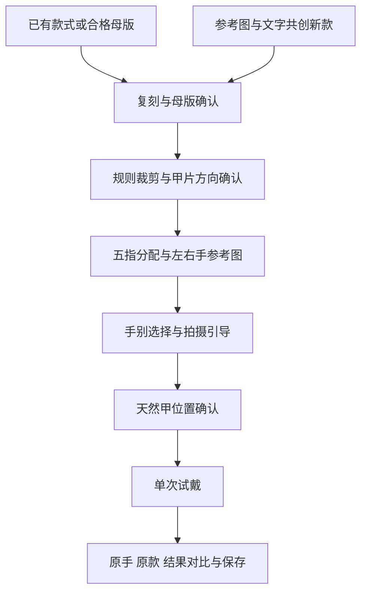

# 产品决策与流程

## 定位如何形成

最初从 AI 美甲共创与个人效果预览出发，后续聚焦高端门店到店试戴：消费者在制作前确认上手效果，门店价值假设是减少沟通和返工。后者尚未通过门店试点或付费验证。

当前品牌为 Muse10。早期其他品牌路演方案已被放弃，其价格、市场规模、佣金与订单目标不作为本案例的成果。

## 研究方法与局限

2026 年 9 月的早期调研采用 10 题匿名问卷，取得 9 份消费者便利样本。没有针对高消费用户、穿戴甲购买者或门店采购人员进行样本筛选。

| 问题信号 | 结果 | 如何用于产品判断 |
| --- | --- | --- |
| 无法提前看到本人上手效果 | 8/9，多选 | 将个人预览作为核心问题继续验证 |
| 希望只改目标一指，其他保持不变 | 7/9，单选 | 将局部修改与保持其余设计纳入后续质量目标 |
| 先完成设计，再决定制作方式 | 5/9，单选 | 保留设计与用途选择的分离 |
| 最可能促使使用的是本人预览 | 3/9，单选 | 痛点频次与功能首选分别解读 |

这组问卷没有证明门店愿意付费，也没有证明静态试戴足以满足多数用户。静态图片优先是当时基于能力和风险的产品取舍，仍需实际体验验证。

## 两条入口，共享确认流程

**已有款式路径**以保留原款为目标；**创作新款路径**允许依据参考图和文字进行变化。二者的验收目标不同，不能用生成漂亮的创作图替代原款还原。

当前需求基线为 V1.3 与补充的第 18 章。流程设计如下，表示产品目标，不表示所有节点已经形成真实闭环。

已有合格母版可以跳过复刻。当前设计的新款候选为两组；早期三组示意原型属于历史版本。

## 关键决策

| 决策 | 原因 | 当前状态 |
| --- | --- | --- |
| 先确认母版，再进行试戴 | 整图直接生成容易同时改款和改手，难以定位问题 | 已设计；当前后端仍需补齐用户确认门 |
| 方向与定位分开确认 | 甲根甲尖朝向和甲片贴在何处是两个问题 | 有人工坐标存储；旋转与定位消费仍需补齐 |
| 用程序裁剪和拼排原资产 | 减少生成模型在中间步骤重新设计甲片的机会 | 规则裁剪与参考图拼排已实现 |
| 技术成功和视觉质量分开验收 | 文件落盘、接口成功不说明保款和自然度合格 | 已在验收与问题记录中明确 |
| 原款复刻与商品视觉创作分开 | 商品视觉可允许设计延伸，原款试戴需保持确认的设计 | 作为素材与质量规则使用 |
| AR、视频、自动精准定位放在后续 | 先核对静态图片主链路与真实质量 | 当前没有这些能力的落地证据 |

## 从 Badcase 到流程约束

29 项历史问题索引包含已发生失败、需求缺口及通用风险，数量不代表 29 次独立试戴，也不代表 29 项全部解决。

- **漏枚与重复**：母版需核对枚数，不静默跨排补款。
- **甲根甲尖反向**：让方向确认成为独立步骤，并核对旋转是否进入实际输入。
- **左右手与指位错配**：明确手别和每指资产关系，不能直接把图片顺序当作指位。
- **长甲缩短、饰件变化**：分别评估甲型长度、装饰保持和佩戴自然度。
- **重绘手型、肤色或背景**：增加原手对照，避免只看生成图是否漂亮。
- **官网与自研链路效果差异**：冻结同一输入、Prompt、图序、参数与结果，验证差异来源。

## 个人贡献与协作

项目由我与协作者共同推进。我参与并承担研究、范围决策、流程和交互、Prompt、评测与验收工作；AI 编程工具辅助工程实现。共同封装的 Skill 是双方成果，不据此声称全部底层代码或模型能力由我独立完成。
